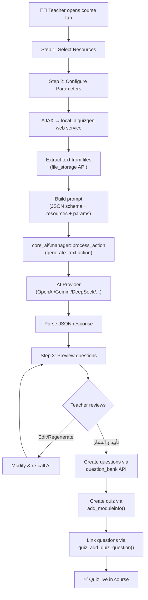

# 🗺️ Wayfinder Map: AI Quiz Generator Plugin for Moodle

`wayfinder:map` · Updated: 2026-10-19

## Destination

A **Moodle local plugin** (`local_aiquizgen`) that gives teachers an AI-powered quiz generation tab inside their course. The teacher selects course resources (PDFs, documents), configures quiz parameters (question types, difficulty, count), and the AI generates a complete quiz — previewed, editable, and published directly into Moodle's native Quiz module and Question Bank. Simple, teacher-controlled, production-ready for university-level exams.

## Notes

- **Domain**: Moodle 6.0dev LMS plugin development (PHP, Mustache, AMD/JS)
- **Platform**: MOODEL — custom Moodle deployment at `d:\code\Hemat\MOODEL`
- **Core AI Subsystem**: Plugin MUST use `core_ai\manager` with `generate_text` action — leverages all configured providers (OpenAI, Gemini, DeepSeek, Anthropic, Ollama, etc.)
- **Key Constraint**: Integrate with existing Moodle features, not reinvent them
- **Quality Standard**: University-level exam questions — serious, academic, pedagogically sound

---

## Decisions so far

- [**Plugin Architecture Type**](#) — `local_aiquizgen` as a pure `local` plugin. Uses `core_ai\manager` directly for AI, adds course tab via `secondary_extend` hook, has own DB tables, pages, and templates. Not an `aiplacement`.

- [**AI Output Format**](#) — Structured JSON. LLM outputs a well-defined JSON schema per question type. Plugin parses JSON and creates questions via `question_bank::get_qtype()->save_question()`. Most reliable for LLMs, easiest validation and error recovery.

- [**Question Type Scope (MVP)**](#) — All 6 types supported from day one (university-level standard): **Multiple Choice**, **True/False**, **Short Answer**, **Essay**, **Matching**, **Ordering**.

- [**Publishing Strategy**](#) — Both: questions go to a dedicated Question Bank category AND a quiz is auto-assembled. BUT — quiz is only created/published **after the teacher reviews and explicitly approves** (not auto-publish). Teacher must click "تأیید و انتشار" after preview.

- [**Teacher Workflow UX (Ticket 4)**](#) — 4-Step Dedicated Full-Page Wizard inside the course tab ("آزمون‌ساز هوشمند"):
  1. **انتخاب منابع**: اسکن خودکار فایل‌های درس (PDF/PPT/DOCX) + فیلد متن دلخواه استاد
  2. **تنظیم پارامترها**: تعداد سوالات (اسلایدر ۳ تا ۳۰)، سطح دشواری دانشگاهی (مفهومی/تحلیلی/پیشرفته)، انتخاب ۶ نوع سوال، انتخاب زبان و مدل
  3. **پیش‌نمایش و اصلاح**: کارت‌های تفکیک‌شده برای هر ۶ نوع سوال، ویرایش مستقیم متن (Inline)، حذف، و بازتولید هوشمند با فیلد چت مجزا برای هر سوال
  4. **تأیید نهایی و انتشار**: خلاصه آماری، تنظیمات اختصاصی ماژول آزمون مودل (زمان، تعداد تلاش، رفتار بازخورد، دسته‌بندی بانک سوالات) و دکمه ساخت آزمون

- [**Monitoring & Analytics Strategy (Ticket 9)**](#) — Hybrid Monitoring & AI Quality Feedback Loop:
  1. **داشبورد پایش سریع در پلاگین**: نمایش فهرست آزمون‌های تولیدشده توسط هوش مصنوعی به همراه تعداد شرکت‌کنندگان، وضعیت تصحیح، و میانگین نمرات در خود تب پلاگین.
  2. **اتصال عمیق به گزارش‌های نیتیو مودل (`mod_quiz\report`)**: دسترسی تک‌کلیکه به گزارش آماری ضریب تمایز و ضریب دشواری تک‌تک سوالات (`report_statistics`)، جدول پاسخ‌های تک‌تک دانشجویان (`report_responses`)، و گزارش نمرات (`report_overview`).
  3. **حلقه بازخورد کیفیت AI (Quality Feedback Loop)**: ثبت دقیق نرخ ویرایش استاد، تعداد بازتولیدها و سوالات حذف‌شده در جدول `local_aiquizgen_questions` برای کالیبراسیون و بهبود خودکار پرامپت‌های بعدی.

- [**PDF & Document Text Extraction Strategy (Ticket 3)**](#) — Zero-Dependency Native PHP Extractor (`\local_aiquizgen\text_extractor`):
  1. **DOCX / PPTX**: Unzips OpenXML packages (`word/document.xml`, `ppt/slides/slide*.xml`) via PHP's built-in `ZipArchive` and strips tags to return clean structured text.
  2. **PDF**: Pure-PHP PDF stream decoder extracting text blocks (`Tj`/`TJ`) and decompressing FlateDecode streams via `gzuncompress`.
  3. **TXT / HTML / MD**: Read directly via `$file->get_content()` and sanitized.
  4. Works out-of-the-box on all Moodle servers without requiring external binaries (`pdftotext`, `tika`, or Python).

- [**Prompt Engineering & JSON Schema (Ticket 6)**](#) — Rigid academic JSON schema implemented in `\local_aiquizgen\ai_service::build_system_prompt()`:
  1. Enforces strict JSON output with zero markdown fences.
  2. Defines typed question specs for all 6 university question types (`multichoice`, `truefalse`, `shortanswer`, `essay`, `match`, `ordering`).
  3. Calibrates Bloom's taxonomy difficulty based on the `difficulty` parameter (standard, analytical, hard).
  4. Automatically strips reasoning tags (e.g., `<think>...</think>`) using Moodle's `\core_ai\helper`.

- [**Preview & Edit Interface Architecture (Ticket 7)**](#) — Moodle AMD Module + Mustache Architecture:
  1. Fully integrated into Moodle's frontend architecture via `amd/src/wizard.js` and `templates/wizard.mustache`.
  2. Uses `core/ajax` for asynchronous calls to the plugin's 4 external webservices.
  3. Provides inline contentEditable question editing, instant question deletion, and single-question micro-reprompting.

- [**Database Schema Design (Ticket 10)**](#) — Persistent Session & Quality Tracking (`db/install.xml`):
  1. `local_aiquizgen_sessions`: Tracks teacher, course, prompt, difficulty, question types, and target quiz.
  2. `local_aiquizgen_questions`: Stores generated questions, JSON payload, edit flags, and reprompt counters for AI quality analytics.

- [**Mastra Workflow Engine Mode (Approved)**](#) — Workflows with Parallel Generation & HITL Suspend/Resume:
  1. **DAG-Based Orchestration**: Replaces unpredictable conversational loops with a typed, deterministic Directed Acyclic Graph using `@mastra/core/workflows`.
  2. **Parallel Generation**: Executes MCQ, True/False, and Essay generation concurrently via `.parallel([generateMCQStep, generateTrueFalseStep, generateEssayStep])`.
  3. **Human-in-the-Loop Suspend & Resume**: Statefully pauses via `step.suspend()` with `suspendSchema` while the teacher conducts inline edits, resuming only on teacher publish approval (`step.resume()`).
  4. **Dual-Engine Fallback**: Seamless fallback in Moodle (`local_aiquizgen`) to native `\core_ai\manager` if Mastra service is offline.

---

## Not yet specified

- **Multi-language prompt support** — should prompts be localizable or hardcoded English/Persian?
- **Rate limiting / quota per teacher** — beyond core_ai's built-in rate limiter, do we need course-level quotas?
- **Backup/restore integration** — should generated quiz metadata survive Moodle backup/restore?
- **Plugin admin settings page** — global defaults for prompt templates, max questions per generation, etc.

## Out of scope

_(none ruled out yet)_

---

## Open Tickets

*(All 10 tickets resolved! Destination reached — the way is completely clear and the plugin implementation is committed.)*

---

## Architecture Overview

